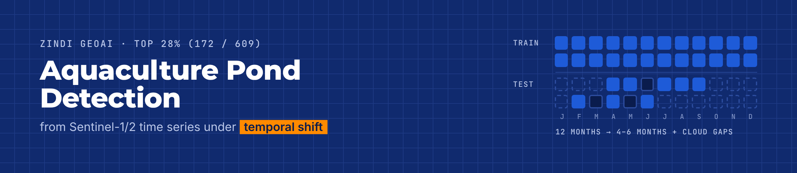
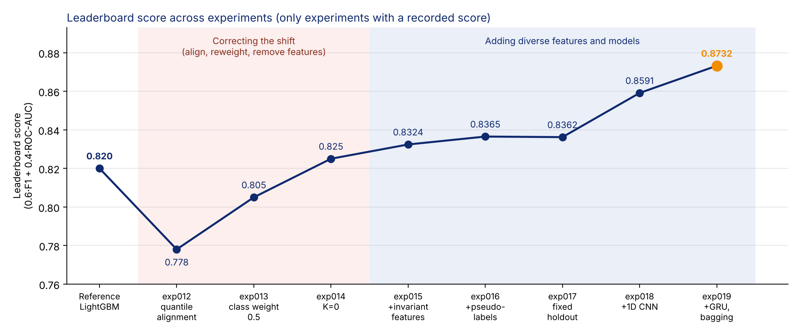
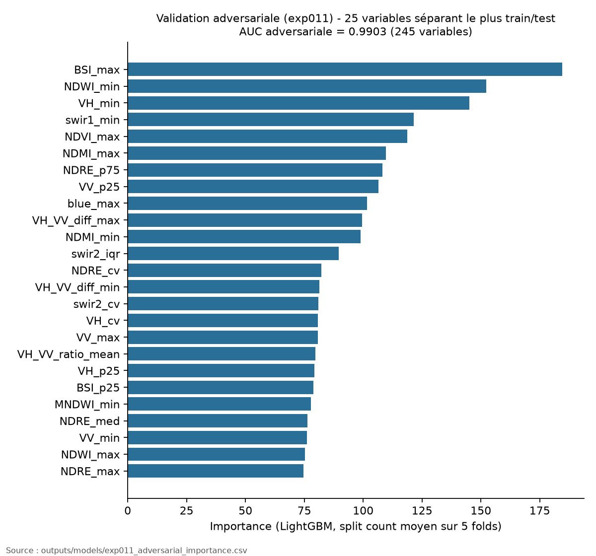

<!-- Add assets/banner.png (1280 × 400), then uncomment the next line. -->
<!--  -->

# Aquaculture pond detection from satellite time series (Zindi GeoAI competition)

A model that tells aquaculture ponds apart from other land cover using monthly Sentinel-1 and Sentinel-2 time series, built to hold up when the test data comes from a different time period. It ranked in the top 28% (172/609) of a Zindi GeoAI competition.


<p align="center">
  
  <br><em>Leaderboard score across 20 experiments. Correcting the shift directly failed. Adding diverse features and temporal models worked.</em>
</p>

## TL;DR

- **Problem:** Classify 10 m × 10 m patches as aquaculture pond or not. The model is trained on 12 months of data and tested on a different period that covers only 4 to 6 months, with cloud gaps.
- **Solution:** Adversarial validation to measure the train/test shift, a validation set that looks like the test, and a blend of gradient boosting, 1D CNN and GRU models.
- **Result:** Leaderboard score raised from 0.820 to 0.873 over 20 documented experiments. **Top 28% (172/609).**

## Competition result

| Competition | Platform | Rank | Participants | Metric |
|---|---|---|---|---|
| Aquaculture Pond Identification (Zindi GeoAI) | Zindi | **172** | 609 | 0.6 · F1 + 0.4 · ROC-AUC = 0.873 |

The leaderboard metric weights F1 at 60% and ROC-AUC at 40%. The binary prediction must use the fixed 0.5 threshold: tuning the threshold is forbidden by the rules.

## The problem

Aquaculture ponds farm fish and shrimp. Mapping them from satellites helps water management and environmental monitoring where ground data is scarce.

The hard part is the time shift. Training data covers 12 full months. Test data covers a different period with only 4 to 6 consecutive months, and 60.52% of test values are missing. A model that is excellent on familiar data can fail on the test set.

| | Train | Test |
|---|---|---|
| Samples | 1,821 | 1,030 |
| Months observed | 12 | 4–6 consecutive, with Sentinel-2 cloud gaps |
| Missing values | 0.00% | 60.52% |
| Positive class (pond) | 40.36% | not published |

**Inputs:** 12 bands per month. Sentinel-1 radar gives VH and VV. Sentinel-2 optical gives blue, green, red, re1, re2, re3, nir, nira, swir1 and swir2.

## Approach

### 1. Simulate the test conditions during training

Each training sample is copied 10 times. Each copy keeps a random window of 4 to 6 months and gets simulated Sentinel-2 gaps that follow the test distribution. A diagnostic (exp010) checked that the simulated missing-month structure matches the real test set. The largest difference between the two was 0.0003.

### 2. Measure the shift: adversarial validation

I trained a classifier to tell training rows from test rows. If it cannot, the two sets look alike. It reached **AUC 0.9903**, so the shift is severe.

The 0.9903 run uses 245 features, and later runs on other feature sets gave 0.9776 to 0.9977. The features that separate the sets most are extremes and spreads, for example `BSI_max`, `NDWI_min` and `VH_min`.

<p align="center">
  
  <br><em>Features that best separate train from test (exp011, LightGBM importance averaged over 5 folds).</em>
</p>

This explained a key observation. Cross-validation stayed around 0.975 while the leaderboard was at 0.820, so cross-validation was not measuring what the test measures.

### 3. Build a validation set that looks like the test

From exp014 on, I held out the 25% of training groups that the adversarial classifier judged most similar to the test (455 groups out of 1,821). This holdout was frozen in exp017 and used to choose models and blend weights.

### 4. Features and models

- **Gradient boosting (LightGBM):** 409 tabular features. 245 are statistics per band and spectral index (mean, std, min, max, median, quartiles, range, IQR, coefficient of variation) plus 5 context features. The other 164 are within-sample features such as band ranks, temporal shape and self-normalised contrasts.
- **1D CNN:** reads the raw monthly sequence (12 bands plus a 12-channel mask of observed months). It uses two convolution blocks with 32 filters and global mean and max pooling.
- **Bidirectional GRU:** a recurrent network on the same input, with 1 layer and 32 hidden units.
- **Blend:** a weighted average of the probabilities: 0.4 GBDT, 0.3 CNN, 0.3 GRU. The weights were found by grid search on the test-like holdout. Each neural network is bagged over 5 seeds.

The neural networks are less correlated with the GBDT on the test set than in cross-validation. For example, the GBDT/CNN correlation drops from 0.9752 to 0.8883. That is why blending them helps.

**Stack:** Python · NumPy · pandas · scikit-learn · LightGBM · PyTorch · XGBoost, CatBoost and Optuna (explored, not in the final model)

## Results

| Model | Test-like holdout | Leaderboard |
|---|---|---|
| Reference LightGBM (245 features) | — | 0.820 |
| LightGBM, 409 features + pseudo-labels (exp016) | 0.9489* | 0.8365 |
| LightGBM + 1D CNN (exp018) | 0.9662 | 0.8591 |
| **LightGBM + 1D CNN + GRU (exp019)** | **0.9676** | **0.8729** (0.8732 with pseudo-labels) |

All scores use 0.6 · F1 + 0.4 · ROC-AUC with the 0.5 threshold. Holdout scores are not comparable to the leaderboard, because the holdout is drawn from the training period. *exp016 used an earlier version of the holdout, before it was frozen in exp017.

### Experiment log

Local validation means 5-fold StratifiedGroupKFold cross-validation (CV) for exp001–013 and the test-like holdout from exp014 on. A dash means no leaderboard score was recorded.

| # | What changed | Local validation | Leaderboard | What I learned |
|---|---|---|---|---|
| | **Phase 1: optimise cross-validation** | | | |
| 001 | Baseline: LightGBM, 245 features, 10 masked copies | CV 0.9747 | — | Reference pipeline |
| 002 | Remove 60 redundant features | CV 0.9739 | — | Worse on 3 seeds, so all features were kept |
| 003 | Keep MNDWI and NDRE, drop NDVI, NDWI and AWEI | CV 0.9741 | — | Worse, so feature pruning was dropped |
| 004 | Class weight from 1.0 to 2.5 | CV 0.9747 → 0.9750 | — | Weight 1.6 kept; small effect |
| 005 | 5 model families compared | XGBoost 0.9754, LightGBM 0.9750 | — | Boosting beats bagging; small gaps |
| 006 | Average of LightGBM, XGBoost and CatBoost | CV 0.9756 | — | +0.0002, within noise |
| 007 | Optuna tuning of XGBoost (40 trials) | CV 0.9746 | — | Tuning did not beat manual settings |
| 008 | Optuna tuning of LightGBM and CatBoost | CatBoost 0.9749 | — | Only CatBoost gained (+0.0008) |
| 009 | Blend with optimised weights, 3 seeds | CV 0.9758 | — | Gain within noise; weights unstable across seeds |
| | **Phase 2: diagnose the shift** | | | |
| 010 | Compare simulated and real test masking | — | — | Masking is correct; the gap comes from the values themselves |
| 011 | Adversarial validation | AUC 0.9903 | — | Severe shift; reweighting by propensity abandoned (weights up to 1062) |
| 012 | Align distributions per domain with quantiles or ranks | CV 0.9748 | 0.778 | Alignment destroys useful information |
| 013 | Class weight sweep 0.5–2.0 | CV 0.9744–0.9752 | 0.805 | Class weight is not a useful lever |
| 014 | Remove the K most shifted features; build the test-like holdout | 0.9472 (K=0) → 0.9333 (K=150) | 0.825 | Shifted features are still needed |
| | **Phase 3: add diversity** | | | |
| 015 | Add 164 within-sample features (409 total) | 0.9524 | 0.8324 | More diverse features help, even though they are not shift-invariant |
| 016 | Pseudo-labels on confident test rows (≥ 0.90) | 0.9489 | 0.8365 | +0.0041; a second round hurts |
| 017 | Frozen holdout; blend of 3 boosting models | 0.9582 | 0.8362 | Plateau; blending 3 tree models adds nothing |
| 018 | 1D CNN on raw sequences, blended with GBDT | 0.9662 | 0.8591 | +0.0226; the CNN errs differently from the trees |
| 019 | Add bidirectional GRU, bag networks over 5 seeds | 0.9676 | 0.8729 / 0.8732 | Final model; pseudo-labels no longer help (+0.0003) |
| 020 | Separate radar and optical models (7 models) | 0.9687 | — | In progress, see next steps |

## What I learned

- **Diagnose before optimising.** Phase 1 improved cross-validation by about 0.001 while the leaderboard stayed at 0.820. Adversarial validation showed why, and it changed the direction of the work.
- **Correcting a shift directly can backfire.** Distribution alignment, propensity reweighting and removing shifted features all lowered the score.
- **Diversity was the main lever.** Temporal networks that read the raw sequence gave the largest gain (+0.0226), because their errors on the test differ from those of tree models.
- **What I would do differently:** build the test-like holdout and run adversarial validation on day one, and log the leaderboard score of every submission.

## Limitations & next steps

- **Covariate shift only.** Adversarial validation measures differences in the inputs, not changes in the link between inputs and labels.
- **Holdout vs leaderboard.** The test-like holdout ranks models more like the leaderboard than CV does, but it still comes from the training period.
- **Missing standalone scores.** Leaderboard scores of each model alone were not recorded, so the contribution of each blend member is known only on the holdout.
- **Unfinished: exp020.** Separate models for radar (Sentinel-1) and optical (Sentinel-2) data reached 0.9687 on the holdout, but no leaderboard score is recorded yet.
- **Untested ideas:** stacking with logistic regression on out-of-fold predictions; early stopping and dedicated architecture search for the networks; error analysis of the non-pond class; separating the gains from bagging and from the GRU in exp019.

## Run it locally

Download `Train.csv`, `Test.csv` and `SampleSubmission.csv` from the competition page and place them in `data/`. Then run the following commands:

```bash
git clone https://github.com/CedricKonkobo/aquaculture-zindi.git
cd aquaculture-zindi
pip install -r requirements.txt

python -m experiments.exp001_baseline.run                  # baseline
python -m experiments.exp011_adversarial_validation.run    # adversarial validation
python -m experiments.exp017_blend_pseudo.run              # creates the frozen test-like holdout
python -m experiments.exp019_consolidation.run             # final blend -> outputs/submissions/
```

exp019 trains 110 models and takes several hours on CPU. Each experiment folder has its own `run.py` and a `results.md` with its findings.

## Repository structure

```
aquaculture-zindi/
├── assets/          # figures used in this README
├── data/            # competition CSVs (not versioned)
├── experiments/     # exp001 … exp020: run.py, config.yaml, results.md
├── notebooks/       # 01_EDA.ipynb: exploratory analysis
├── src/             # preprocessing, augmentation, features, training, CNN/GRU, inference
├── outputs/         # models, submissions, figures (not versioned)
├── requirements.txt
└── README.md
```

---

**Cédric Konkobo** · AI & Data Engineering, ENSAM Rabat · [GitHub](https://github.com/CedricKonkobo)
